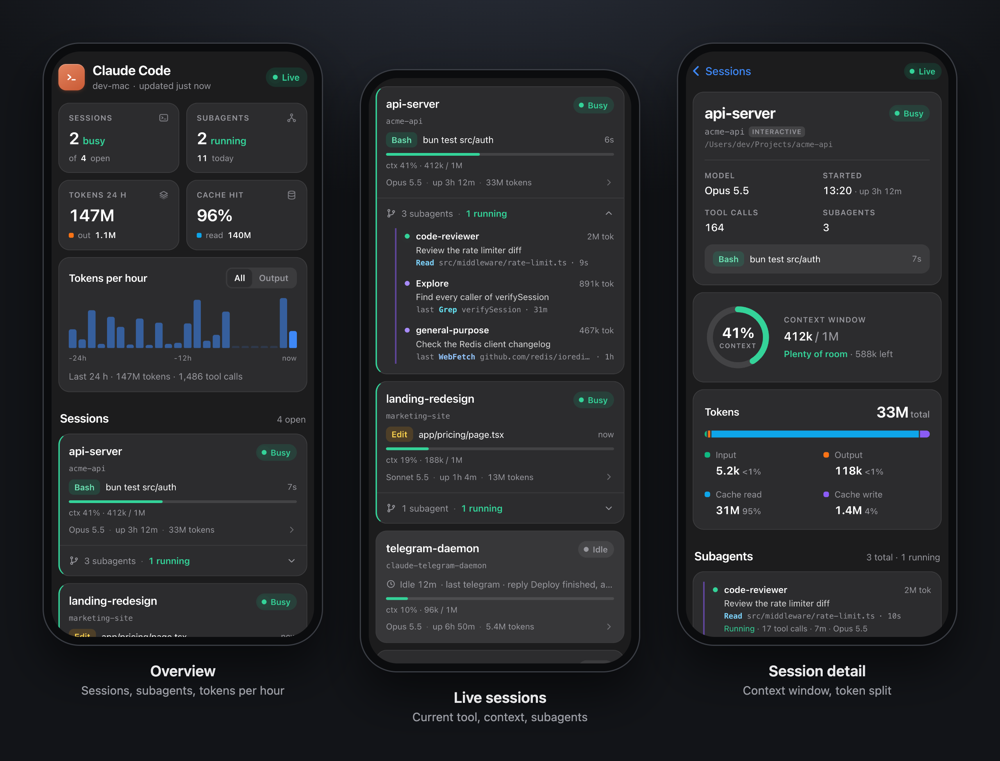

<div align="center">


<h3>The official Claude Code Telegram plugin is good. This one is better.</h3>

<br />

<a href="https://github.com/k1p1l0/claude-telegram-supercharged/blob/master/LICENSE"></a>
<a href="https://github.com/k1p1l0/claude-telegram-supercharged/stargazers"></a>
<a href="https://github.com/k1p1l0/claude-telegram-supercharged/commits/master"></a>

<br />

<a href="#getting-started">Getting Started</a>
<span>&nbsp;&nbsp;&bull;&nbsp;&nbsp;</span>
<a href="#features">Features</a>
<span>&nbsp;&nbsp;&bull;&nbsp;&nbsp;</span>
<a href="#agentic-mode">Agentic Mode</a>
<span>&nbsp;&nbsp;&bull;&nbsp;&nbsp;</span>
<a href="#tools-exposed-to-the-assistant">Tools Reference</a>
<span>&nbsp;&nbsp;&bull;&nbsp;&nbsp;</span>
<a href="#contributing">Contributing</a>

<br />
<hr />
</div>

https://github.com/user-attachments/assets/51f9f8c4-886d-4aec-bf2a-dddc8ef15cfc

## Claude Telegram Supercharged

Drop-in upgrade for the [official Claude Code Telegram plugin](https://github.com/anthropics/claude-plugins-official/tree/main/external_plugins/telegram). Install once, get 15+ features the official plugin doesn't have. Built on top of the [official plugin](https://github.com/anthropics/claude-plugins-official/tree/main/external_plugins/telegram) -- everything works, just better.

2 minutes to install. Zero config. Your existing bot and pairing keep working.

### Install in one line

Install the official plugin first (in Claude Code: `/plugin install telegram@claude-plugins-official`), then:

```sh
curl -fsSL https://raw.githubusercontent.com/k1p1l0/claude-telegram-supercharged/master/install.sh | bash
```

Run it again any time to update. The full walkthrough is in [Getting Started](#getting-started).

> **Security:** the only official source is [github.com/k1p1l0/claude-telegram-supercharged](https://github.com/k1p1l0/claude-telegram-supercharged). This project never ships zip or exe downloads. Copies elsewhere that offer a zip file are malware; please don't run them, and report them to GitHub.

### Live demo

One take in a real chat on a Mac, 52 seconds. A voice message goes in and local whisper transcribes it. Agentic Mode shows each tool call while Claude checks GitHub, and the answer comes back as an ElevenLabs voice message. Then `/agents` opens the Agents Board. Waits and typing are sped up, and the video shows by how much.

https://github.com/user-attachments/assets/4c5a5968-b5cc-43f1-a756-4282d3eedae9

### Official vs Supercharged

| | Official plugin | Supercharged |
| --- | --- | --- |
| Text, photos, files, stickers | ✅ | ✅ |
| Formatted replies, long-message splitting | ✅ | ✅ |
| Voice messages | Raw audio file | ✅ Transcribed (OpenAI, Groq, Deepgram or local Whisper) |
| Voice replies | ❌ | ✅ ElevenLabs |
| Live progress while Claude works | ❌ | ✅ [Agentic Mode](#agentic-mode) |
| History and memory that survive restarts | ❌ | ✅ SQLite + memory file |
| Knows which message you replied to | ❌ | ✅ Reply context, quotes, forwards |
| Questions with inline buttons | ❌ | ✅ `ask_user` |
| Scheduled messages and reminders | ❌ | ✅ Also syncs to Apple Reminders |
| Google Calendar | ❌ | ✅ |
| 24/7 daemon with auto-restart | ❌ | ✅ launchd supervisor |
| Model routing (Haiku / Sonnet / Opus) | ❌ | ✅ |
| Long answers as Telegraph articles | ❌ | ✅ |
| Approve permission prompts from Telegram | ✅ | ✅ Buttons or "yes <id>", plus an auto-approve list |
| Live board of sessions, subagents and tokens | ❌ | ✅ [`/agents` Mini App](#agents-board-mini-app) |

## Features

### Voice & Audio

| Feature | What it does |
| --- | --- |
| **🎤 Voice Messages** | Talk to Claude. Provider fallback chain: OpenAI Whisper → Groq → Deepgram → local whisper-cli. Works from your phone while walking. |
| **🔊 Voice Replies (TTS)** | Claude replies with voice messages via ElevenLabs TTS. OGG/Opus native format. Auto-fallback to audio file if voice is restricted. |
| **🎤 Auto-transcribe** | ALL voice messages in group chats are transcribed, even without mentioning the bot. Configurable via `autoTranscribe`. |

### Messages & Media

| Feature | What it does |
| --- | --- |
| **📨 Forwarded Messages** | Full forwarding context preserved -- Claude sees who originally sent it and from which chat/channel. |
| **📦 Message Batching** | Forward 20+ messages at once -- collected into one batch (5s debounce), auto-summarized instantly, then Claude responds to the whole conversation in one reply. |
| **📄 Document Support** | Send PDFs, DOCX, CSV, TXT, JSON -- Claude downloads, reads, and summarizes. 10MB file size limit. |
| **🎨 MarkdownV2 Auto-escaping** | Special characters auto-escaped server-side -- Claude writes natural text, no manual `\.` escaping needed. |
| **🔤 Incoming Formatting** | Bold, italic, strike, underline, spoiler, code, code blocks with language, quotes and hidden links in your messages reach Claude as Markdown, instead of being dropped by Telegram's plain-text `text` field. Captions and replied-to messages too. |
| **😎 Sticker & GIF Support** | Claude sees stickers and GIFs. Static as images, animated as multi-frame collages. |
| **📰 Telegraph Instant View** | Long research (3000+ chars) published to telegra.ph as Instant View. Disabled by default -- opt-in via `TELEGRAPH_ENABLED=true`. |

### Conversations & Groups

| Feature | What it does |
| --- | --- |
| **💬 Message History** | SQLite-backed rolling store. Claude has context across restarts. `get_history` + `search_messages` tools. |
| **🧠 Conversation Memory** | `/clean` saves a summary before clearing. Memory persists across sessions. Claude never forgets. |
| **🧵 Conversation Threading** | Follows reply chains in groups, sees who said what, responds in the correct thread. Up to 3 levels deep. |
| **📋 Forum Topics** | Telegram Forum topics fully supported. Each topic isolated with persistent `thread_id`. |
| **👥 Group Pairing** | Add bot to group, mention it, get pairing code. No hunting for numeric chat IDs. |
| **🎯 Inline Buttons** | `ask_user` tool -- tappable buttons for confirmations and choices. |
| **👍 Reaction Status** | 👀 read → 🔥 working → 👍 done. Voice messages get ✍ for transcription. |

### Daemon & Infrastructure

| Feature | What it does |
| --- | --- |
| **⚡ Two-Tier Model Routing** | Configurable router: Haiku (fast, 200K), Sonnet (balanced, 1M), or Opus (deep, 1M). Set via `TELEGRAM_ROUTER_MODEL`. Complex tasks auto-escalate to Opus via subagents (change the target with `TELEGRAM_ESCALATION_MODEL`). |
| **🛠 Agentic Mode** | Watch Claude work: "typing…" the whole time, plus a live "Working… (Ns)" message with Claude's notes and each tool call as it runs. The answer replaces it in place. `/verbose 0\|1\|2`, `/status`, `/new`. [Details](#agentic-mode) |
| **📊 Agents Board** | `/agents` opens a Mini App in Telegram: every Claude Code session on the Mac, its subagents, context use, tokens per hour and the latest tool calls. [Details](#agents-board-mini-app) |
| **🔄 Daemon Mode** | Supervisor auto-restarts Claude on crash or context reset. Memory preserved, zero downtime. |
| **🛡 Context Watchdog** | Auto-restarts when context exceeds 50%, or after 2 hours of uptime, to keep sessions responsive. SQLite history and memory survive restarts. |
| **🔒 Single-Instance Lock** | PID-based lock file prevents duplicate bot instances competing for Telegram updates. || **🖥 Daemon Management** | `/telegram:daemon start\|stop\|restart\|status\|logs` -- full lifecycle. `/telegram:monitor` for health dashboard with remote control URL. |
| **⏰ Scheduled Messages** | `schedule` tool for reminders and recurring tasks. "at" (one-shot) and "every" (interval) types. Persists across restarts. |
| **📅 Google Calendar** | Check schedule, create events, daily briefings from Telegram. Multi-account support. Proactive — Claude uses calendar context when answering. |
| **📸 Headless Screenshots** | Playwright-based page capture -- works in daemon mode where Chrome isn't available. |
| **✅ Reaction Validation** | Client-side emoji whitelist prevents cryptic Telegram API errors. |
| **🔒 Shell Injection Protection** | All subprocess calls use `spawnSync` with array args. No shell interpretation. |
| **📊 Smart Caching** | Voice/audio cached between middleware and handlers. No double downloads or transcriptions. |

## Getting Started

> Default pairing flow for a single-user DM bot. See [ACCESS.md](./ACCESS.md) for groups and multi-user setups.

### Prerequisites

- [Bun](https://bun.sh) -- the MCP server runs on Bun. Install with `curl -fsSL https://bun.sh/install | bash`.

### 1. Create a bot with BotFather

Open a chat with [@BotFather](https://t.me/BotFather) on Telegram and send `/newbot`. BotFather asks for two things:

- **Name** -- the display name shown in chat headers (anything, can contain spaces)
- **Username** -- a unique handle ending in `bot` (e.g. `my_assistant_bot`). This becomes your bot's link: `t.me/my_assistant_bot`.

BotFather replies with a token that looks like `123456789:AAHfiqksKZ8...` -- that's the whole token, copy it including the leading number and colon.

### 2. Install the [official plugin](https://github.com/anthropics/claude-plugins-official/tree/main/external_plugins/telegram)

These are Claude Code commands -- run `claude` to start a session first.

```
/plugin install telegram@claude-plugins-official
```

### 3. Apply the supercharged version

Clone this repo and install both the supercharged server and the daemon supervisor:

```sh
git clone https://github.com/k1p1l0/claude-telegram-supercharged.git
PLUGIN_DIR=~/.claude/plugins/cache/claude-plugins-official/telegram/$(ls ~/.claude/plugins/cache/claude-plugins-official/telegram/ | sort -V | tail -1)
cp claude-telegram-supercharged/server.ts claude-telegram-supercharged/miniapp.ts claude-telegram-supercharged/decisionTap.ts claude-telegram-supercharged/needsList.ts $PLUGIN_DIR/
cp -R claude-telegram-supercharged/miniapp $PLUGIN_DIR/
mkdir -p ~/.claude/scripts
cp claude-telegram-supercharged/supervisor.ts ~/.claude/scripts/telegram-supervisor.ts
cp claude-telegram-supercharged/scripts/claude-daemon-wrapper.exp ~/.claude/scripts/claude-daemon-wrapper.exp
chmod +x ~/.claude/scripts/claude-daemon-wrapper.exp
cp claude-telegram-supercharged/scripts/telegram-progress-hook.ts ~/.claude/scripts/telegram-progress-hook.ts
```

### 4. Give the server the token

```
/telegram:configure 123456789:AAHfiqksKZ8...
```

Writes `TELEGRAM_BOT_TOKEN=...` to `~/.claude/channels/telegram/.env`. You can also write that file by hand, or set the variable in your shell environment -- shell takes precedence.

### 5. Relaunch with the channel flag

The server won't connect without this -- exit your session and start a new one:

```sh
claude --channels plugin:telegram@claude-plugins-official
```

Or use the **daemon supervisor** for always-on operation with auto-restart and context reset from Telegram (see [Daemon Mode](#daemon-mode)):

```sh
bun ~/.claude/scripts/telegram-supervisor.ts
```

### 6. Pair

With Claude Code running from the previous step, DM your bot on Telegram -- it replies with a 6-character pairing code. If the bot doesn't respond, make sure your session is running with `--channels`. In your Claude Code session:

```
/telegram:access pair <code>
```

Your next DM reaches the assistant.

> Unlike Discord, there's no server invite step -- Telegram bots accept DMs immediately. Pairing handles the user-ID lookup so you never touch numeric IDs.

### 7. Lock it down

Pairing is for capturing IDs. Once you're in, switch to `allowlist` so strangers don't get pairing-code replies. Ask Claude to do it, or `/telegram:access policy allowlist` directly.

### Updating

> **Important:** The official plugin auto-updates and will overwrite your supercharged `server.ts`. When the bot suddenly stops working after an update, this is why.

The quickest way to update (also after an official plugin update) is to re-run the [one-line installer](#install-in-one-line). To do it by hand:

When the official plugin updates (check for new version directories in `~/.claude/plugins/cache/claude-plugins-official/telegram/`):

```sh
cd claude-telegram-supercharged
git pull
# Find the current version (e.g. 0.0.4)
PLUGIN_VERSION=$(ls ~/.claude/plugins/cache/claude-plugins-official/telegram/ | sort -V | tail -1)
echo "Updating to version: $PLUGIN_VERSION"
cp server.ts miniapp.ts decisionTap.ts needsList.ts ~/.claude/plugins/cache/claude-plugins-official/telegram/$PLUGIN_VERSION/
cp -R miniapp ~/.claude/plugins/cache/claude-plugins-official/telegram/$PLUGIN_VERSION/
cp supervisor.ts ~/.claude/scripts/telegram-supervisor.ts
# Copy skills
cp -r skills/* ~/.claude/plugins/cache/claude-plugins-official/telegram/$PLUGIN_VERSION/skills/
# Copy scripts
cp scripts/claude-daemon-wrapper.exp ~/.claude/scripts/claude-daemon-wrapper.exp
cp scripts/telegram-progress-hook.ts ~/.claude/scripts/telegram-progress-hook.ts
```

Then restart your daemon or Claude Code session.

## Tools Exposed to the Assistant

| Tool | Purpose |
| --- | --- |
| `reply` | Send to a chat. Takes `chat_id` + `text`, optionally `reply_to` (message ID) for native threading, `files` (absolute paths) for attachments, and `parse_mode` (MarkdownV2/HTML/plain, defaults to MarkdownV2). Images (`.jpg`/`.png`/`.gif`/`.webp`) send as photos with inline preview; other types send as documents. Max 50MB each. Auto-chunks text; files send as separate messages after the text. Returns the sent message ID(s). |
| `react` | Add an emoji reaction to a message by ID. **Only Telegram's fixed whitelist** is accepted (👍 👎 ❤ 🔥 👀 🎉 😂 🤔 etc). Also used for status indicators (👀 read → 👍 done). |
| `edit_message` | Edit a message the bot previously sent. Supports `parse_mode` (MarkdownV2/HTML/plain). Useful for "working..." → result progress updates. Only works on the bot's own messages. |
| `ask_user` | Send a question with inline keyboard buttons and wait for the user's choice. Takes `chat_id`, `text`, `buttons` (array of labels), optional `parse_mode` and `timeout` (default 120s). Returns the label of the tapped button. |
| `get_history` | Retrieve recent message history from a chat. Takes `chat_id`, optional `limit` (default 50, max 200), optional `before` (unix timestamp for pagination). Returns formatted messages with timestamps, senders, and content. |
| `search_messages` | Search message history by text pattern. Takes `chat_id`, `query` (substring match), optional `limit` (default 20, max 100). Returns matching messages. |
| `clear_history` | Clear all message history for a chat. Always confirm with `ask_user` first, and call `save_memory` before clearing to preserve context. Pass `restart_context: true` to signal the supervisor daemon to restart Claude for a full context reset. |
| `save_memory` | Save a conversation summary to persistent memory. Loaded into Claude's instructions on every startup. Use before `clear_history` so context survives across sessions. |
| `create_telegraph_page` | Publish long-form content to Telegraph (telegra.ph) and return a URL. Telegram renders it as Instant View -- a native article reader. Takes `title`, `content` (Markdown), optional `author_name` and `author_url`. Auto-creates Telegraph account on first use. |

### Inbound Events

| Event | Description |
| --- | --- |
| Text message | Forwarded to Claude as a channel notification with `chat_id`, `message_id`, `user`, `ts`. |
| Photo | Downloaded to inbox, path included in notification so Claude can `Read` it. |
| Emoji reaction | When a user reacts to a bot message, Claude receives a notification with `event_type: "reaction"`, the emoji, and the `message_id`. Use as lightweight feedback. |
| Voice message | Downloaded to inbox as `.ogg`, auto-transcribed by the server if whisper is installed. Transcription replaces "(voice message)" in the notification text. Audio path still included as `audio_path`. |
| Audio file | Forwarded audio files (`.mp3`, etc.) downloaded to inbox, path included as `audio_path`. |
| Sticker | Static `.webp` passed directly as `image_path`. Animated (`.tgs`) and video (`.webm`) stickers converted to multi-frame collage. Emoji and pack name included in text. |
| GIF / Animation | Downloaded and converted to a multi-frame horizontal collage so Claude can see the animation content. |

Inbound messages trigger a typing indicator automatically -- Telegram shows "botname is typing..." while the assistant works on a response.

## Voice & Audio Messages

Voice messages and audio files are downloaded to `~/.claude/channels/telegram/inbox/` and automatically transcribed by the server. The transcription text replaces "(voice message)" in the notification, so Claude receives the spoken text directly.

Think of it as **Wispr Flow for Claude Code**. Open Telegram, hold the mic button, say "refactor the auth middleware to use JWT" -- Claude gets that as text and starts working. No typing, no desktop app needed, works from your phone.

### Transcription Setup

The server tries transcription methods in this order:

1. **OpenAI Whisper API** (recommended) -- fastest, highest quality, non-blocking. Set your API key in `~/.claude/channels/telegram/.env`:
   ```
   OPENAI_API_KEY=sk-proj-...
   ```
   Uses `whisper-1` by default ($0.006/min). You can switch to a different model:
   ```
   OPENAI_WHISPER_MODEL=gpt-4o-transcribe
   ```
   No local install needed. The active transcription method is logged at startup.

2. **[whisper.cpp](https://github.com/ggml-org/whisper.cpp)** (local fallback) -- `brew install whisper-cpp`. Fast C++ port, runs fully offline. Requires a model file:
   ```sh
   # Download the small multilingual model (465MB, good quality/speed balance)
   mkdir -p /usr/local/share/whisper-cpp/models
   curl -L -o /usr/local/share/whisper-cpp/models/ggml-small.bin \
     "https://huggingface.co/ggerganov/whisper.cpp/resolve/main/ggml-small.bin"
   ```
3. **[openai-whisper](https://github.com/openai/whisper)** (local fallback) -- `pip install openai-whisper`. Python-based, slower but also works offline.
4. **No transcriber** -- voice messages are still downloaded and the `audio_path` is included in the notification, but no transcription is provided.

Local options (2 & 3) require **ffmpeg** (`brew install ffmpeg`) for audio format conversion. If you have an OpenAI API key, option 1 is recommended -- it's async (doesn't block the event loop), faster, and more accurate.

### Auto-transcription in history

When `autoTranscribe` is enabled (the default), the server transcribes **all** voice/audio messages in group chats -- even ones that don't mention the bot. This means `get_history` and the auto-injected context always show the spoken text (prefixed with 🎤) instead of `[voice]`. Claude gets full conversational context including what people said in voice messages.

To disable (e.g. to save CPU on busy groups):

```sh
/telegram:access set autoTranscribe false
```

To re-enable:

```sh
/telegram:access set autoTranscribe true
```

## Telegraph (Instant View Articles)

Claude can publish long-form content to [Telegraph](https://telegra.ph) and send it as Instant View links in Telegram -- a native full-screen article reader. Telegraph is **disabled by default** because posts are publicly accessible by URL.

To enable, add to `~/.claude/channels/telegram/.env`:

```
TELEGRAPH_ENABLED=true
```

When enabled, Claude only uses Telegraph for truly long content (3000+ characters with multiple sections) -- research reports, comprehensive analyses, detailed guides. Regular replies always stay in chat.

When disabled (default):
- The `create_telegraph_page` tool is hidden from Claude
- Claude sends all content directly in chat messages
- The system prompt does not mention Telegraph

Requires MCP server restart to take effect.

## Conversation Memory

When you clear chat history, Claude first saves a short summary to `~/.claude/channels/telegram/data/memory.md`. This file is loaded into Claude's instructions on every startup -- so context from previous sessions is never fully lost.

- Summaries are dated and tagged with the chat ID
- File auto-compresses when it exceeds 10,000 characters (older half gets trimmed)
- Works across `/clear` and Claude Code restarts

## Daemon Mode

The plugin ships with a **supervisor script** (`supervisor.ts`) that runs Claude Code as a managed child process. It handles:

- **Auto-restart on crash** -- exponential backoff (1s, 2s, 4s... up to 30s), resets after 60s of stable uptime
- **Context reset from Telegram** -- say "clear everything" in Telegram, Claude saves memory, clears history, and the supervisor restarts Claude with a fresh session. Zero downtime, memory preserved.
- **Signal file protocol** -- the MCP server writes `~/.claude/channels/telegram/data/restart.signal`, the supervisor detects it within 500ms, waits 3 seconds for Claude to finish sending replies, then kills and respawns

### Usage

If you followed the [Getting Started](#getting-started) steps, the supervisor is already installed at `~/.claude/scripts/telegram-supervisor.ts`. Just run:

```sh
bun ~/.claude/scripts/telegram-supervisor.ts
```

Extra flags are forwarded to Claude:

```sh
bun supervisor.ts --effort high
```

The supervisor spawns Claude with `--channels plugin:telegram@claude-plugins-official --dangerously-skip-permissions` by default.

### Agentic Mode

In daemon mode you can watch Claude work, the way you would in the terminal:

```
You: Read the README and check package.json for the scripts
Bot: Working... (14s)
     💬 Reading the README to see the install steps.
     💻 Bash: Read README intro
     💬 Now checking package.json for the scripts.
     📖 Read: package.json
     ✍️ Writing…
Bot: [the answer replaces the Working message]
```

- **Typing indicator** for the whole time Claude works, at every verbosity level. It pauses while an `ask_user` question waits for your answer.
- **Working message** once a turn runs longer than 2.5 seconds, so quick replies never get one. It shows Claude's short notes (💬), each tool call as it starts (Read, Edit, Bash, Grep, WebFetch, Agent, Skill, MCP tools and so on), and what Claude is doing right now: `💭 Thinking…` after a tool returns, `✍️ Writing…` once it is producing output.
- **The answer replaces the Working message** in place. Telegram sends no push notification for edits, so these answers arrive silently. Quick answers, multi-part answers, files and quote-replies arrive as normal messages.
- The Working message is always the newest message. If you write while Claude works, it moves below your message. Telegram's own tools (reply, react and so on) and `ToolSearch` aren't listed.
- DMs only, because tool lines can show file paths and commands.

| Command | What it does |
| --- | --- |
| `/verbose 0` | No Working message: typing indicator and the answer only |
| `/verbose 1` | Notes and tool names with a short target (default) |
| `/verbose 2` | Longer notes and full tool inputs (commands, paths, URLs) |
| `/status` | Working or idle, elapsed time, tool count, uptime, router model |
| `/new` | Fresh Claude session through the supervisor. Memory and history are kept. |
| `/agents` | Opens the [Agents Board](#agents-board-mini-app) Mini App |
| `/usage` | Your messages and tokens for today and the last 7 days, and your [limits](#usage-stats--limits). Admins also see every user. |
| `/<your command>` | Runs a Claude Code skill you mapped in `commands.json`. See [Custom commands](#custom-commands). |

The built-in commands answer allowlisted users in DMs. `/usage` also answers group members in groups the bot is in. `/verbose` is stored per chat.

**How it works.** The supervisor passes `scripts/telegram-progress-hook.ts` to Claude as a `PreToolUse`, `PostToolUse` and `Stop` hook via `--settings`, so it never runs in your interactive sessions. The hook appends each event to `~/.claude/channels/telegram/data/progress.jsonl`, and the server tails that file and edits the Working message (at most one edit per 1.5 seconds). Claude's notes and the thinking/writing phase come from the session transcript. The server's instructions ask Claude to write one short sentence before each tool call.

**Config** (supervisor environment): `TELEGRAM_VERBOSE` sets the default level (1). `TELEGRAM_AGENTIC_MODE=off` turns the hook off.

### Agents Board (Mini App)

`/agents` opens a live board inside Telegram for every Claude Code session on the Mac, not only the daemon:

- **Sessions:** busy or idle, the tool running now, context use (green below 50%, yellow to 80%, red above), model, uptime and tokens.
- **Subagents:** running and recently finished, with their current tool and tokens.
- **Last 24 hours:** tokens per hour (input, output, cache read, cache write), tool calls and cache hit rate.
- **Recent tool calls** across all sessions.
- **Other machines:** switch to any other computer that runs the plugin. See [Several machines](#agents-board-mini-app) below.



**How it works.** The instance that owns the bot runs a small HTTP server on `127.0.0.1:8790`. A worker thread reads `claude agents --json` for the live sessions and the transcripts in `~/.claude/projects` for tokens, tool calls and subagents. It reads only new bytes, and only while someone has the board open. Every API request must carry Telegram's signed `initData` from a user on your allowlist, so the URL shows nothing to anyone else.

**Setup.** Telegram opens Mini Apps only over HTTPS, so the board needs an HTTPS address that your phone can reach.

The easiest way needs no account:

1. Install cloudflared: `brew install cloudflared`.
2. Add `TELEGRAM_MINIAPP_URL=auto` to `~/.claude/channels/telegram/.env`.
3. Restart the daemon and send `/agents`.

The bot then starts a Cloudflare quick tunnel and puts its address on the `/agents` button. The address is random and changes when the bot restarts. After a restart, send `/agents` again, because older buttons stop working.

For a fixed address, use your own HTTPS setup:

1. Put the port behind HTTPS. For a private address that works on devices in your tailnet: `tailscale serve --bg 8790`. For a public address: `tailscale funnel --bg 8790` or a named Cloudflare Tunnel.
2. Add the address to `~/.claude/channels/telegram/.env`, for example `TELEGRAM_MINIAPP_URL=https://my-mac.tail1234.ts.net`. Serve the board at the root of that address, or make the proxy strip the path.
3. Restart the daemon and send `/agents`.

| Variable | Default | What it does |
| --- | --- | --- |
| `TELEGRAM_MINIAPP_URL` | not set | HTTPS address of the board, or `auto` for a Cloudflare quick tunnel (needs `cloudflared`). Until it is set, `/agents` replies with these setup steps. |
| `TELEGRAM_DECISIONS_OWNER` | first admin, else first allowlisted user | The chat the telegram-decisions skill sends decision cards to (its `OWNER`). The Needs you list answers only for this user, because the tap row and the card edit go to this chat. Set it when the skill's owner is not the first admin or allowlisted user. |
| `TELEGRAM_MINIAPP_PORT` | `8790` | Local port of the board. |
| `TELEGRAM_MINIAPP_NAME` | computer name | Machine name in the board header. |
| `TELEGRAM_MINIAPP` | on | `off` turns the board off. |
| `TELEGRAM_MINIAPP_PEERS` | not set | Other machines the board can switch to, as `name=url` pairs separated by commas. |
| `TELEGRAM_MINIAPP_PEER_TOKEN` | not set | Shared secret (16+ characters) between the machines. Without it, `TELEGRAM_MINIAPP_PEERS` is ignored. |
| `TELEGRAM_MINIAPP_HOST` | `127.0.0.1` | Address the board server binds. Set it on a machine that other boards read from. |
| `TELEGRAM_MINIAPP_CONTROL` | on | `off` turns the session controls off. The board stays read-only. |
| `TELEGRAM_MINIAPP_TOWN_FEED` | not set | URL of a town feed (see [Town view](#town-view)). Without it the Town view is hidden. |
| `TELEGRAM_MINIAPP_TOWN_TOKEN` | not set | Sent to the town feed as `Authorization: Bearer <token>`. It stays on the server. |
| `TELEGRAM_MINIAPP_DELEGATE_BUNDLE` | `~/.claude/channels/telegram/private/delegate-board.miniapp.js` | Absolute path of an optional Delegate board bundle (see [Delegate board](#delegate-board)). |

**Several machines.** If you run Claude Code on more than one computer, one board can show all of them. Tap the machine name in the header to switch. Every machine runs this plugin with its own bot.

1. Pick a long random secret, for example with `openssl rand -hex 24`, and put the same `TELEGRAM_MINIAPP_PEER_TOKEN` in the `.env` of every machine.
2. On each other machine, make the board reachable from the main one. With Tailscale, set `TELEGRAM_MINIAPP_HOST` to that machine's tailnet address, or to `::` for all addresses.
3. On the machine whose bot you use, list the others: `TELEGRAM_MINIAPP_PEERS=studio=http://studio:8790,laptop=http://laptop:8790`.
4. Restart the daemons and open `/agents`.

The main board fetches the other machine's data when you select it. The request carries the shared secret, and the board only fetches addresses from `TELEGRAM_MINIAPP_PEERS`. Plain HTTP is fine inside a tailnet, because Tailscale encrypts the traffic.

**Session controls.** Admins can act on sessions from the board. If `access.json` lists no `admins`, everyone on the allowlist can. Other users get the board read-only.

- **Read:** the last messages of a session, with each tool call on one line, for example `[Bash] git status`.
- **Send:** continue a session with a message. A background session that finished its turn is stopped and resumed with your message. A session that is still working, or a terminal session, gets a background copy that starts with your message.
- **New task:** start a background session in a folder the board knows, in plan, accept-edits or default permission mode. For tasks on this machine, the bot messages you when the task finishes.
- **Background sessions:** stop, read the recent output, remove a stopped one.
- **Terminal sessions:** "End session" sends Ctrl+C (SIGINT). Claude Code quits on it, busy or idle, and a reply in progress is lost. The conversation stays on disk, and `claude --resume <id>` continues it.
- **The bot's own session:** "New session" does the same as `/new`. The board never signals or messages the session it runs in.

On another machine the controls go through the shared secret, unless that machine turned them off. Each user can run 10 actions per minute. Every action goes to the bot's log, without the message text. `TELEGRAM_MINIAPP_CONTROL=off` makes the board read-only.

#### Town view

If you run several agents that talk to each other, the board can draw them as a small pixel-art town. Each room is a project (plus one hub), each agent is a character in its room, and a new message flies across as an envelope. The plugin does not collect this data itself: it shows whatever a town feed returns.

Set `TELEGRAM_MINIAPP_TOWN_FEED` (and `TELEGRAM_MINIAPP_TOWN_TOKEN` if the feed needs one) and restart. The Sessions header then gets a third view next to Board and List. The bot fetches the feed on the server, with a 3 second timeout and a 1 MB limit, keeps only the fields below, and serves the result at `GET /api/town` with the same Telegram sign-in as the rest of the board. On another machine from `TELEGRAM_MINIAPP_PEERS` the board shows that machine's town, if it has a feed.

- **Characters:** a different sprite for a Claude daemon, a pi agent, a Claude session and anything else. Idle agents breathe, busy ones type behind a laptop, waiting ones show a red "!", offline ones turn grey. Tap an agent for its role, department, state, activity, last message in and out, its recent messages and open tasks.
- **Rooms:** a sign with the room title, a task board with the number of open tasks and the first three, and one rug per department.
- **Messages:** an envelope flies from sender to receiver when both are on screen. The latest messages are also listed under the town. Tap either for the preview.

With reduced motion the characters stand still and envelopes appear in place.

The feed is JSON, schema version 1. Times can be ISO strings or epoch seconds or milliseconds. Unknown fields are dropped.

```json
{
  "version": 1,
  "generated_at": "2026-10-17T10:00:00Z",
  "machine": "studio",
  "rooms": [{ "id": "hub", "title": "HQ", "kind": "hub" }, { "id": "shop", "title": "shop", "kind": "project" }],
  "agents": [{
    "name": "sales@shop", "room": "shop", "department": "sales", "role": "Outbound",
    "kind": "claude-session", "listening": true, "state": "waiting",
    "waiting_for": "approval to send", "activity": "→ claude: batch ready",
    "last_in": "2026-10-17T09:58:00Z", "last_out": "2026-10-17T09:59:00Z"
  }],
  "messages": [{ "id": "42", "from": "sales@shop", "to": "claude", "ts": "2026-10-17T09:59:00Z", "task_id": "7", "preview": "Batch ready" }],
  "tasks": [{ "id": "7", "project": "shop", "title": "Send the batch", "state": "open", "owner": "sales@shop", "updated_at": "2026-10-17T09:59:00Z" }]
}
```

`kind` is `claude-daemon`, `pi`, `claude-session` or `other`. `state` is `busy`, `waiting`, `idle` or `offline`. `messages` are newest first, at most 50. A task may also carry a short `priority`. A task counts as open unless its state is done, closed, completed, cancelled, merged, resolved or archived. Agents and tasks whose room is unknown go to the hub.

#### Delegate board

The Town can also show a read-only Delegate board under the rooms. The board is not part of this repo: it is an optional, private JavaScript bundle that you put on the machine yourself. Without it the section stays hidden and nothing else changes.

- **Where:** `~/.claude/channels/telegram/private/delegate-board.miniapp.js`, or the absolute path in `TELEGRAM_MINIAPP_DELEGATE_BUNDLE`. The path is read once at start; the file is read again when it changes. Files over 3 MB are refused.
- **File and folder:** the file must be a regular file that you own and that group and others cannot write. Its folder must be a real folder (not a symlink) that you own and that group and others cannot write. Symlinks, FIFOs, sockets and devices are refused. A refused bundle hides the section, and the bot logs the reason once. On Linux with a umask of 002, new folders and files are group-writable, so set the modes yourself: `chmod 700` on the folder and `chmod 600` on the file. The file is read through one opened descriptor. It is refused for that request if its size, inode or modification time changes while it is read, or if after the open the path no longer leads to the file that was opened. A same-size write within one tick of the file system's clock can still go unnoticed. On Windows the board is always off.
- **Folders above it:** only the folder that holds the file is checked. The folders above it are not checked or pinned, and they may be symlinks (on macOS `/var` and `/tmp` are). The reader trusts them: each one must be owned by you or by root, and no one else may be able to write to it. Your home folder is fine. Someone who can rename or replace a folder above the bundle can race the reader. After the open, the reader checks again that the path leads to the file it opened. That catches some swaps, such as a folder swapped in for the open and back before the check, but each check walks the path again, so it does not rule out a swap and restore timed around the checks. Folders above the bundle that only you or root can change are the real protection.
- **Who gets it:** the board serves the file at `GET /api/delegate-bundle` with the same Telegram sign-in as the rest of the board, so only users on the allowlist can download it, even through a public tunnel. It is never cached (`Cache-Control: private, no-store`). With no file the route answers 404.
- **What the bundle must do:** be one self-contained script that sets `window.DelegateBoardBundle = { version: 1, mount(el, props) }`, where `mount` returns `{ update(props), unmount() }`. `props` is `{ town: { agents, tasks }, theme: "light" | "dark" }`, with `agents` and `tasks` exactly as `GET /api/town` returns them. The page calls `update` on every town refresh and theme change.
- **Failures:** a 404, a network error or another `version` hides the section. So does a bundle that throws: while it runs, from a timer or promise it started, in `mount`, in `update`, or later. The page tells the bundle's errors from its own by the file or stack trace that an error names. An uncaught error or rejection that names no script (a rejection with a plain value, or an error with no stack) cannot be traced, so from the start of the load on it also turns the board off, even when the page's own code caused it. The page then unmounts the board and does not load the bundle again until the Mini App is reloaded.
- **Trust:** the bundle runs from a `blob:` URL as trusted same-origin code, with the viewer's privileges in the Mini App. It can call every API route the page can, session controls included. The loader is no sandbox. The only check on who gets the bundle is the Mini App's Telegram sign-in and allowlist; there is no separate entitlement check. Only put a bundle you trust at that path. The page's Content-Security-Policy allows `blob:` scripts for it.

The layout and metrics take ideas from [Claude-Code-Agent-Monitor](https://github.com/hoangsonww/Claude-Code-Agent-Monitor).

### Needs you (Mini App)

The page has a view called **Needs you** next to Board, List and Town. It is one list of what waits for you, with answer buttons. The Board column for sessions that wait on their own prompt is called **Waiting on prompt**.

- **Decisions.** Open decisions from the `telegram-decisions` skill (`~/.claude/tg-decisions/state.json`), live first, then the old queue, then the rest oldest first. Each shows the options of its Telegram card in the same order, Later included. Texts are cut and anything shaped like a token is replaced.
- **Task approvals.** Pending rows of `~/agent-inbox/tasks.db`, opened read-only (`TELEGRAM_MINIAPP_TASKS_DB` moves the path). They say "Answer in Telegram": the board has no write path to them.
- **Badge and default.** The Needs you button always shows its text and a count of open decisions plus pending approvals (nothing for 0, `9+` above nine), refreshed every 15 s even when another view is open. On the first open of a session the page opens on Needs you when the count is above 0, unless you have already picked a view; the remembered view is not replaced, and the Board is one tap away.
- **Inbox NEEDS YOU blocks.** Not read yet. The answer says `not wired`.
- **Status.** `GET /api/needs` returns `decisions`, `approvals` and `inbox`, each with its own `status` (`ok`, `error` or `not wired`) and `items`, so an empty list is different from a broken source. The page polls every 5 s while the view is on screen. The server keeps a result for at most 2 s.
- **Reading state.json.** The read takes a shared `flock` on `~/.claude/tg-decisions/.state.lock`, the lock the skill's writer holds exclusively, through `flock(1)` or a `python3 -I` helper. A writer that holds the lock for more than a few seconds makes the read fail with an error. There is no retry loop.
- **Answering.** `POST /api/needs/answer` with `{code, version, option}` (and `project` when two projects use the same code) and the usual Telegram sign-in. The server reads the state again and takes the label from it, never from the page. It refuses with a JSON `error` and `reason`: 409 `stale` (the version changed), 409 `closed`, 409 `not_answerable` (an old reply-keyboard decision, a card that is not sent yet, or a card that shows an older version), 400 `unknown_option`, 400 `ambiguous`, 404 `not_found`, 503 `state_unreadable`. When it accepts, it runs the same code as a button tap in Telegram: one row `<CODE> <label>` with a negative id and `reply_to_msg_id` = the card, and the card's keyboard becomes the inert done button. A second tap on the same version returns the first answer with `already: true` and writes no second row.
- **Files.** The route needs `needsList.ts` and `decisionTap.ts` next to `server.ts`.

### Custom commands

You can add your own bot commands and map each one to a Claude Code skill. List them in `~/.claude/channels/telegram/commands.json`:

```json
{
  "commands": {
    "standup": { "skill": "daily-standup", "description": "Daily standup summary" },
    "report": { "skill": "weekly-report" }
  }
}
```

Send `/standup` and Claude runs the `daily-standup` skill. Any text after the command goes to the skill as arguments, for example `/standup only the backend team`.

- The commands appear in the bot's menu in DMs, after the built-in ones.
- You don't need to restart after editing the file. The server checks it on every message and every 30 seconds.
- A custom command is handled like any other message: the same allowlist, reactions, batching and Agentic Mode. Message history keeps what you typed.
- In groups, send `/standup@your_bot`. If the group requires a mention, a bare `/standup` is held like any other unmentioned message, and reaches Claude only if a mention follows within 5 seconds.
- Forwarded messages never run a command, and unknown commands still reach Claude as plain text.

| Field | What it does |
| --- | --- |
| name (the key) | 1 to 32 characters: `a-z`, `0-9` and `_`. |
| `skill` | Required. The skill name as Claude Code knows it, for example `daily-standup` or `plugin:skill`. |
| `description` | Optional menu text, up to 256 characters. The default is `Run the <skill> skill`. |

The server skips an entry with a bad name, a built-in name (`status`, `verbose`, `new`, `agents`) or no skill, and logs it to stderr. Telegram allows 100 commands, which leaves room for 96 of your own.

**How it works.** In place of `/standup`, Claude receives `Run the "daily-standup" skill with the Skill tool.` and an `Arguments:` line when there are arguments. The notification also carries `command` and `skill` attributes. If the daemon restarts before Claude answers, the replayed message gets the same rewrite.

### Webhook mode

By default the bot asks Telegram for new messages with long polling. In webhook mode Telegram sends each update to the bot over HTTPS instead. Use it on a server with a fixed public address.

1. Give the local server, the Agents Board server on `127.0.0.1:8790`, an HTTPS address that Telegram can reach: `tailscale funnel --bg 8790`, a named Cloudflare Tunnel or a reverse proxy. Serve it at the root of that address, or make the proxy strip the path. Telegram accepts only ports 443, 80, 88 and 8443.
2. Add to `~/.claude/channels/telegram/.env`:
   ```
   TELEGRAM_WEBHOOK=on
   TELEGRAM_WEBHOOK_URL=https://bot.example.com
   ```
3. Restart the daemon. The log shows `webhook: Telegram posts updates to https://bot.example.com/telegram/webhook`.

Without `TELEGRAM_WEBHOOK_URL` the bot uses the board's address from `TELEGRAM_MINIAPP_URL`. With `TELEGRAM_MINIAPP_URL=auto` it waits up to 60 seconds for the quick tunnel, and sets the webhook again each time the tunnel gets a new address. Addresses from `tailscale serve` work only inside your tailnet, so Telegram cannot reach them.

**How it works.** The instance that owns the bot calls `setWebhook` with `<address>/telegram/webhook`, the same update types as polling, and a secret token that is new on every start. The local server takes `POST /telegram/webhook` and answers 401 to any request without that token. Updates are handled one at a time and in order, as with polling. The bot answers each request within 8 seconds; a slow update, such as a long voice note, keeps running after that. If there is no HTTPS address, or Telegram rejects it, the bot logs why and falls back to polling. When you turn webhook mode off, polling deletes the old webhook first, so there is nothing to clean up. Telegram reports failed deliveries only through `getWebhookInfo`. The bot checks it 15 seconds after it sets the webhook and then every 5 minutes, and logs each new error.

| Variable | Default | What it does |
| --- | --- | --- |
| `TELEGRAM_WEBHOOK` | off | `on` receives updates by webhook instead of long polling. |
| `TELEGRAM_WEBHOOK_URL` | board address | Public HTTPS address that forwards to `127.0.0.1:8790` (or `TELEGRAM_MINIAPP_PORT`). The bot adds `/telegram/webhook`. |

`TELEGRAM_MINIAPP=off` turns the board off, but the server keeps running for the webhook route. It also stops the quick tunnel, so set `TELEGRAM_WEBHOOK_URL` then.

### Usage stats & limits

The bot counts each user's messages per day, delivered and blocked, and the tokens (input, output, cache write and cache read) of every turn their messages started. You can cap messages per minute, messages per hour and tokens per day, for everyone or for one user.

`/usage` shows your numbers for today and the last 7 days, and your limits. Admins also get a line for every user. In a group, it shows only your own numbers.

**How it works.** Before a message reaches Claude, the server checks the sender's limits. If the sender is over a limit, the message is dropped and counted as blocked. The sender gets one short notice per window, for example `Limit reached: 20 messages per hour. Try again in 14 min.`, and no notice for more messages in the same window. The tokens per day limit lasts until the next midnight UTC. Every Telegram message counts, so 10 forwarded messages count as 10. A reaction that reaches Claude starts a turn too, so it counts as a message, and reactions from a user who is over a limit are dropped.

Tokens come from the session transcript in `~/.claude/projects`. The server reads only new bytes, as the Agents Board does. Each API call goes to the user whose Telegram message started the turn, which is the sender of the newest Telegram message in the transcript. Turns typed in the terminal or started by `/loop` have no owner and aren't counted. Subagent tokens count for the user too. The server finds the transcript from the path that the daemon's progress hook reports. Without the hook, it uses `CLAUDE_PROJECT_DIR` and `CLAUDE_CODE_SESSION_ID`, which Claude Code passes to every MCP server.

For limits, tokens = input + output + cache write. Cache reads are shown separately and never count. They make up most of every call and are much cheaper than input, so counting them would make any limit meaningless.

The server keeps stats in `messages.db` (table `usage_daily`) for 90 days. It stores the minute and hour windows there too, so a restart or `/new` doesn't reset them.

**Config** goes in `~/.claude/channels/telegram/access.json`. Every field is optional. A missing value or 0 means no limit, so the bot works as before until you set one.

```json
{
  "limits": { "messagesPerMinute": 5, "messagesPerHour": 60, "tokensPerDay": 2000000 },
  "userLimits": { "412587349": { "messagesPerHour": 200 } },
  "admins": ["628194073"]
}
```

| Field | Default | What it does |
| --- | --- | --- |
| `limits.messagesPerMinute` | no limit | Messages a user can send to Claude in any 60 seconds. |
| `limits.messagesPerHour` | no limit | Messages a user can send to Claude in any 60 minutes. |
| `limits.tokensPerDay` | no limit | Input + output + cache write tokens per user per UTC day. |
| `userLimits.<userId>` | not set | The same keys for one user. Each key set here replaces the default, and `0` removes that limit. |
| `admins` | none | User IDs with no limits. In a DM, their `/usage` lists every user. |

### How context reset works

1. User sends "clear everything" in Telegram
2. Claude confirms via inline buttons (`ask_user`)
3. Claude saves a conversation summary (`save_memory`)
4. Claude sends a confirmation reply to Telegram
5. Claude calls `clear_history` with `restart_context: true`
6. The MCP server writes `restart.signal` with a 3-second delay
7. Supervisor detects the file, waits for Claude to finish, then kills the process
8. Supervisor spawns a fresh Claude session -- memory.md is loaded into instructions automatically

### Always-on with launchd (macOS)

Running the supervisor in a terminal (or tmux/screen) works for quick sessions, but has a fundamental problem on macOS: **the system suspends background processes aggressively**. When you close the lid, switch users, or the Mac goes to sleep, macOS sends `SIGSTOP` to terminal processes — your bot goes silent until you open the lid again. tmux/screen don't help because they run in userspace and get suspended too.

**launchd** is Apple's native process manager — the same system that keeps Spotlight, Time Machine, and iCloud running. It operates at the OS level, outside of any terminal session, so it:

- **Survives lid close** -- the process keeps running when you close your MacBook (on power)
- **Survives logout** -- stays alive even if you log out of your user session
- **Auto-starts on boot** -- no need to remember to start it after a restart
- **Auto-restarts on crash** -- if the supervisor dies unexpectedly, launchd brings it back
- **Stays awake** -- we wrap the supervisor with `caffeinate -s` to prevent system sleep

#### Setup

Create `~/Library/LaunchAgents/com.user.claude-telegram.plist`:

```xml
<?xml version="1.0" encoding="UTF-8"?>
<!DOCTYPE plist PUBLIC "-//Apple//DTD PLIST 1.0//EN" "http://www.apple.com/DTDs/PropertyList-1.0.dtd">
<plist version="1.0">
<dict>
    <key>Label</key>
    <string>com.user.claude-telegram</string>

    <key>ProgramArguments</key>
    <array>
        <string>/usr/bin/caffeinate</string>
        <string>-s</string>
        <string>/path/to/bun</string>
        <string>/Users/YOU/.claude/scripts/telegram-supervisor.ts</string>
    </array>

    <key>RunAtLoad</key>
    <true/>

    <key>KeepAlive</key>
    <true/>

    <key>StandardOutPath</key>
    <string>/Users/YOU/.claude/channels/telegram/data/supervisor-stdout.log</string>

    <key>StandardErrorPath</key>
    <string>/Users/YOU/.claude/channels/telegram/data/supervisor-stderr.log</string>

    <key>EnvironmentVariables</key>
    <dict>
        <key>PATH</key>
        <string>/path/to/bun/dir:/usr/local/bin:/usr/bin:/bin:/usr/sbin:/sbin</string>
    </dict>

    <key>WorkingDirectory</key>
    <string>/Users/YOU</string>

    <key>ProcessType</key>
    <string>Background</string>

    <key>ThrottleInterval</key>
    <integer>10</integer>
</dict>
</plist>
```

Replace `/path/to/bun` with your bun path (`which bun`) and `/Users/YOU` with your home directory.

> **Don't override `HOME` in the plist.** The wrapper runs claude from `~/.claude-telegram-daemon`, because a cwd of `$HOME` makes Claude Code drop the telegram plugin. To use another directory, set `TELEGRAM_DAEMON_CWD` in `EnvironmentVariables`. If the daemon misbehaves, see [Daemon Troubleshooting](docs/DAEMON-TROUBLESHOOTING.md).

> **Important:** Both `RunAtLoad` and `KeepAlive` should be set to `<true/>` for hands-off operation. `RunAtLoad` starts the daemon automatically on login/boot. `KeepAlive` tells launchd to restart the process if it exits unexpectedly. Setting either to `<false/>` means you'll need to manually start the daemon or it won't recover from crashes.

#### Managing the daemon

**Start the daemon:**

```sh
launchctl load ~/Library/LaunchAgents/com.user.claude-telegram.plist
```

**Stop the daemon:**

```sh
launchctl unload ~/Library/LaunchAgents/com.user.claude-telegram.plist
```

**Check if it's running:**

```sh
launchctl list | grep claude-telegram
```

A running daemon shows its PID in the first column. A `0` in the status column means it exited cleanly; non-zero means it crashed (launchd will restart it).

**View logs:**

```sh
tail -f ~/.claude/channels/telegram/data/supervisor-stderr.log
```

**Restart (reload config after editing the plist):**

```sh
launchctl unload ~/Library/LaunchAgents/com.user.claude-telegram.plist
launchctl load ~/Library/LaunchAgents/com.user.claude-telegram.plist
```

**Remove completely (stop + delete):**

```sh
launchctl unload ~/Library/LaunchAgents/com.user.claude-telegram.plist
rm ~/Library/LaunchAgents/com.user.claude-telegram.plist
```

#### Monitoring the daemon

Use the built-in monitor skill from any Claude Code session:

```
/telegram:monitor
```

Shows a live dashboard: process status for all components, launchd state, recent logs, MCP health, remote control URL (watch the daemon live in your browser), and lock file status.

You can also monitor manually:

```sh
# Live supervisor logs
tail -f ~/.claude/channels/telegram/data/supervisor-stderr.log

# Quick alive check
ps aux | grep "channels.*telegram" | grep -v grep && echo "ALIVE" || echo "DEAD"

# Find the remote control URL (open in browser to watch the daemon live)
strings ~/.claude/channels/telegram/data/supervisor-stdout.log | grep "session_" | tail -1
```

#### How the layers work together

```
launchd (OS-level)
  └── caffeinate -s (prevents system sleep)
        └── supervisor.ts (manages Claude lifecycle)
              └── claude --channels plugin:telegram (the actual bot)
```

- **launchd** ensures the process tree is always alive
- **caffeinate** keeps the Mac awake while the process runs
- **supervisor** handles Claude-specific restarts (context reset, crash recovery with backoff)
- **Claude** runs as a managed child process with the Telegram channel

> **Note:** `caffeinate -s` prevents sleep only when connected to power. On battery with the lid closed, macOS will eventually sleep regardless. For true 24/7 uptime on battery, consider running on a server instead.

## Multiple bots

One session can run several bots, for example a personal bot and a team bot. Each bot keeps its own chats and history, and Claude answers through the bot that got the message.

Add the extra tokens to `~/.claude/channels/telegram/.env`, separated by commas:

```sh
TELEGRAM_BOT_TOKEN=123456789:AAH...           # primary bot
TELEGRAM_EXTRA_BOT_TOKENS=987654321:AAF...,555555555:AAE...
```

Restart the daemon or the session. The log shows one `polling as @...` line per bot. Without `TELEGRAM_EXTRA_BOT_TOKENS`, the server behaves exactly as before.

**How it works.** Every inbound message reaches Claude with a `bot` attribute: the username of the bot that received it. Claude passes it back as the `bot` parameter of `reply`, `react`, `edit_message`, `ask_user`, `voice_reply`, `create_telegraph_page`, `get_history`, `search_messages` and `clear_history`. When a call has no `bot`, the server uses the bot that last received a message from that chat, or the primary bot if there is none. This matters for DMs, because a private chat has the same `chat_id` (the user's id) on every bot.

History is stored per bot, so `get_history` for one bot never shows another bot's conversation with the same person. Messages from before the upgrade belong to the primary bot. Each bot polls under its own lock in `~/.claude/channels/telegram/data/`: the primary keeps `telegram.lock`, and each extra bot gets `telegram-<hash>.lock`. A second session runs MCP-only for every bot that another session already polls.

**Access.** All bots read the same `access.json`. An extra bot uses the primary's allowlist, groups and DM policy unless you give it its own under `bots`, keyed by its username:

```json
{
  "allowFrom": ["412587349"],
  "bots": {
    "team_bot": { "allowFrom": ["412587349", "628194073"], "dmPolicy": "allowlist" }
  }
}
```

[ACCESS.md](./ACCESS.md#per-bot-overrides) has the details, including how pairing works for an extra bot.

**Primary bot only.** A few features stay on the primary bot: Agentic Mode progress (the Working message and the typing refresh), permission prompts and `yes <id>` / `no <id>` answers, the `/status`, `/verbose`, `/new` and `/agents` commands with the Mini App, scheduled jobs, and [webhook mode](#webhook-mode). On an extra bot, `/new` and the other primary-only commands reach Claude as ordinary text. With `TELEGRAM_WEBHOOK=on`, the primary bot gets its updates by webhook (the log shows `webhook mode as @...`) and the extra bots keep long polling, so they need no public address.

**Every bot.** [Custom commands](#custom-commands) and `/usage` work on every bot. Each bot's DM menu lists `/usage` and the commands from `commands.json`; the primary bot also lists its own built-in commands. In a group, `/standup@team_bot` runs only on `@team_bot`. [Usage stats and limits](#usage-stats--limits) count each Telegram user across all bots, so messages to any bot use the same per-minute, per-hour and per-day budget. `limits`, `userLimits` and `admins` stay at the top level of `access.json` and have no per-bot override.

| Variable | Default | What it does |
| --- | --- | --- |
| `TELEGRAM_EXTRA_BOT_TOKENS` | not set | Comma-separated tokens of more bots for this session. `TELEGRAM_BOT_TOKEN` stays the primary bot. |

## Group Chats & Conversation Threading

The plugin supports group chats with smart conversation threading -- Claude can follow reply chains, see who said what, and respond in the correct thread.

### Setup

**1. Disable privacy mode in BotFather**

By default, Telegram bots in groups only see commands and messages that mention them. For full thread tracking, disable privacy mode:

1. Open [@BotFather](https://t.me/BotFather) on Telegram
2. Send `/mybots` → select your bot
3. **Bot Settings** → **Group Privacy** → **Turn off**

> If you prefer to keep privacy mode on, the bot will still work -- it just won't see messages that don't mention it, so thread tracking will be incomplete.

**2. Add the bot to a group**

Add your bot to any Telegram group like a normal member.

**3. Pair the group (automatic)**

Just send a message in the group mentioning your bot (e.g. `@your_bot hello`). The bot replies with a 6-character pairing code -- same flow as DM pairing:

```
/telegram:access pair <code>
```

That's it. The group is registered automatically with `requireMention: true` (bot only responds when mentioned or replied to).

To let it respond to all messages:

```
/telegram:access group update -100XXXXXXXXXX requireMention false
```

> **Manual alternative:** If you already know the group's numeric ID (starts with `-100...`), you can register directly with `/telegram:access group add -100XXXXXXXXXX`. Ways to find the ID: check the bot's stderr logs, open [web.telegram.org](https://web.telegram.org) (ID is in the URL), or forward a group message to [@RawDataBot](https://t.me/RawDataBot).

**4. Restart Claude Code**

```sh
claude --channels plugin:telegram@claude-plugins-official
```

### How Threading Works

- When someone replies to a message in the group, Claude receives `reply_to_text` and `reply_to_user` showing what was replied to
- The plugin tracks up to 200 messages per chat (4-hour TTL) and walks reply chains up to 3 levels deep, providing `thread_context` in the notification
- Claude's own sent messages are tracked too, so reply chains work end-to-end
- Claude automatically threads its responses to the message that triggered them

### Forum Topics

If your supergroup has **Topics** enabled, the plugin forwards `thread_id` (Telegram's `message_thread_id`) and passes it through to replies -- keeping conversations in their correct Forum topic automatically. Topic IDs are persisted in SQLite so context is preserved across restarts.

## Owner stop controls (agent-harness router)

`/stop <task id>`, `/stopall`, `/resume <task id>`, `/resume all`, `/pause`, `/stops`, `/auto` (`on [hours]`, `off`, `status`, `undo <id>`, `stop`, `confirm <n>`) and `/goal`, `/goals` (`new ...`, `<id>`, `done`, `stop`, `pause`, `resume`, `confirm`) are sent to the agent-harness Telegram router (`routerHook.ts`). `/goal` and `/goals` typed by the owner are consumed by this hook and are not forwarded to the model. `/stops` is this bot's name for the router's status command, because `/status` already shows the bot's own state.

- Only a DM from an allowlisted user is handled. Group messages, other users, `/status` and commands tagged for another bot (`/stopall@otherbot`) follow the normal flow.
- `AGENT_HARNESS_ROUTER` sets the router file. Default: `~/Projects/agent-harness/telegram-router.ts`. The router reads the plugin's `access.json` and needs its own opt-in file (`~/agent-inbox/telegram-router.json`).
- `AGENT_HARNESS_STATUS_TEXT` sets the text sent to the router for `/stops`. Default: `/stops`, the router's status command.
- Fail rules: for a non-owner nothing is handled, so nothing changes. For the owner a stop is never swallowed: if the router file or its opt-in is missing, the bot replies "Owner commands are not installed."; if the router throws or does not answer within 20 seconds, the bot replies with an error that says the result is unknown and names the status command to check (`/auto status`, `/goals` or `/stops`).
- `/stopall` replies with Confirm and Cancel buttons (`stp:c:<id>:<generation>` and `stp:x:<id>:<generation>`, 25 bytes at most). A tap re-checks the allowlist, runs the same router command and replaces the message with the result, keeping only the follow-up buttons the router returns (such as Undo). A tap from anyone else only gets a callback answer and the message is left alone. The router rejects an old or used confirm.
- Buttons for `/auto` and `/goal` use their own short prefixes: `aut:c:<n>` / `aut:x:<n>` (confirm, cancel), `aut:u:<id>` (Undo), `aut:s` (`/auto stop`), `gol:c:<n>` / `gol:x:<n>` (confirm, cancel), `gol:s:<id>` (`/goal stop`), all 15 bytes at most. They follow the same rules as `stp:`: the tapper is re-checked, the token is never trusted, and the router rejects stale taps.

## Access Control

Full access control docs in [ACCESS.md](./ACCESS.md) -- DM policies, groups, mention detection, delivery config, skill commands, and the `access.json` schema.

Quick reference: Default policy is `pairing` -- DMs and groups both use the pairing flow. For DMs, message the bot to get a code. For groups, add the bot and mention it to get a code. Then `/telegram:access pair <code>` approves either. `ackReaction` only accepts Telegram's fixed emoji whitelist.

### Permission Approvals

If your session doesn't skip permissions, Claude Code sends each approval request to Telegram. Every allowlisted DM gets a message like `🔐 Permission: Bash` with **See more**, **✅ Allow** and **❌ Deny** buttons. You can also reply `yes <id>` or `no <id>` with the five-letter id from the message. Only allowlisted users can answer, and a request can be answered once; every copy of the prompt then shows the outcome. Group members can't approve.

To skip the round-trip for tools you always allow, list them in `access.json`:

```json
{ "autoApproveTools": ["Read", "Grep", "Glob"] }
```

The daemon runs with `--dangerously-skip-permissions`, so it never asks. This is for sessions you start without that flag.

### Acknowledgment Reactions

The bot can react to incoming messages with an emoji to signal it received and is processing them. This is controlled by the `ackReaction` field in `access.json`:

```json
{
  "ackReaction": "👀"
}
```

**Reaction flow:**

| Stage | Emoji | When |
| --- | --- | --- |
| **Received** | `👀` (configurable via `ackReaction`) | Immediately on receipt |
| **Processing voice** | `✍` | When transcribing a voice message |
| **Working** | `🔥` | During long tasks (multiple tool calls, research, code generation) |
| **Done** | `👍` | After the reply is sent |

Telegram only keeps **one bot reaction per message**, so each new reaction replaces the previous — creating a natural status progression.

**Note:** `ackReaction` is **not set by default**. To enable it, add it to your `~/.claude/channels/telegram/access.json`. It only accepts emoji from [Telegram's fixed reaction whitelist](https://core.telegram.org/bots/api#reactiontypeemoji). Common choices: `👀`, `⚡`, `🔥`.

## Message History Buffer

Every message flowing through the bot is captured in a local SQLite database and persisted across restarts. Claude gets context without asking users to repeat themselves.

```
~/.claude/channels/telegram/data/messages.db
```

**How it works:**
- A grammY middleware intercepts ALL messages (including group messages without @bot mention) before the gate check
- Both inbound messages and bot replies are stored with `INSERT OR REPLACE` dedup
- Last 5 messages are auto-injected into each notification so Claude always has rolling context
- `get_history` retrieves up to 200 messages with pagination; `search_messages` does substring search
- SQLite WAL mode ensures crash-safe writes -- if Claude Code crashes, the DB auto-recovers on next startup
- Rolling buffer prunes automatically: 500 messages/chat cap, 14-day TTL, 50MB hard limit

## Limitations

Telegram's Bot API exposes **no native history endpoint** -- bots only see messages in real-time. We solve this with a local SQLite message store (see [Message History](#message-history-buffer) below). Every message flowing through the bot is captured and persisted, giving Claude full context across restarts via `get_history` and `search_messages` tools. History is available from when the bot joined the chat.

Photos and voice messages are downloaded eagerly on arrival -- there's no way to fetch attachments from historical messages via the Bot API.

## Roadmap

### Completed

- [x] MarkdownV2 formatting
- [x] Emoji reaction tracking
- [x] Ask User inline buttons
- [x] Reaction status indicators (👀 → 🔥 → 👍)
- [x] Voice & audio messages with whisper transcription
- [x] Auto-transcription in history (configurable)
- [x] Sticker & GIF support
- [x] Emoji reaction validation
- [x] Conversation threading
- [x] Forum topic support with persistent thread_id
- [x] Group pairing flow
- [x] Message history buffer (SQLite)
- [x] Session management (clear_history + save_memory)
- [x] Conversation memory persistence
- [x] Shell injection protection (spawnSync)
- [x] Smart media caching (no double downloads)

- [x] Daemon mode supervisor (auto-restart + context reset from Telegram)
- [x] Telegraph Instant View for long-form content
- [x] OpenAI Whisper API with local fallback
- [x] Agentic Mode: live progress, typing indicator, in-place answers
- [x] Remote permission approval (inline buttons, text replies, auto-approve list)
- [x] Agents Board Mini App (`/agents`): live sessions, subagents, context use and tokens per hour
- [x] Custom commands (`commands.json`): bot commands that run Claude Code skills
- [x] Webhook mode: alternative to polling for production deployments
- [x] Rate limiting & usage stats (`/usage`): messages and tokens per user, limits per minute, hour and day
- [x] Multi-bot support: several bots from one server instance, with per-bot history and optional per-bot access
- [x] Scheduled messages: one-time, repeating and cron jobs
- [x] Agents Board session controls: read, send, new task, stop and end sessions from Telegram

## Contributing

This is a community project. We want your help!

1. Fork the repo
2. Create a feature branch (`git checkout -b feature/your-feature`)
3. Make your changes
4. Test with a real Telegram bot
5. Open a PR with a clear description of what you changed and why

### Guidelines

- Keep changes focused -- one feature per PR
- Test with real Telegram interactions, not just unit tests
- Update the README if you add new features or tools
- Follow the existing code style (TypeScript, grammy library)

## Credits

- **Original plugin** by [Anthropic](https://github.com/anthropics) ([source](https://github.com/anthropics/claude-plugins-official/tree/main/external_plugins/telegram)) -- Apache 2.0 licensed
- **Supercharged** by [@k1p1l0](https://github.com/k1p1l0) and contributors
- Inspired by the Claude Code Channels launch by [@boris_cherny](https://www.threads.com/@boris_cherny)

## License

Apache 2.0 -- Same as the original. See [LICENSE](./LICENSE).
